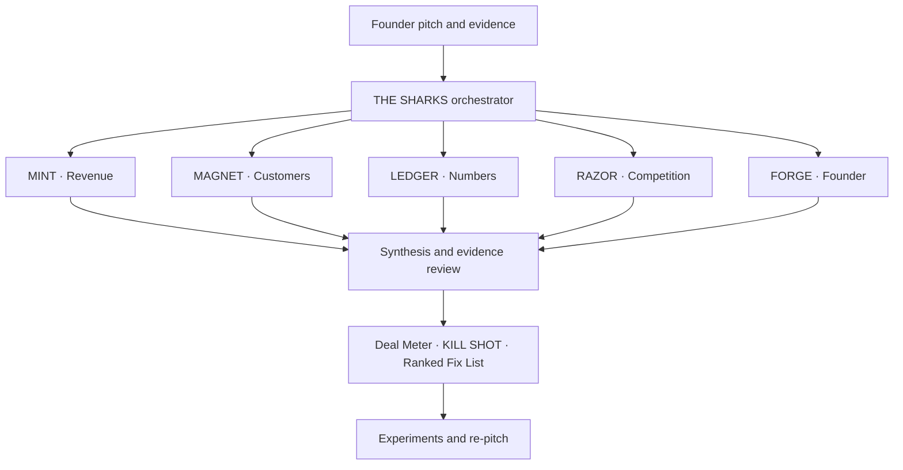

# Architecture

The Sharks uses one orchestration skill and five specialist roles.

The orchestrator normalizes one shared pitch brief, asks each specialist for one high-information question, waits for founder responses, then synthesizes evidence-linked verdicts. If the host cannot run real independent subagents, it executes the roles sequentially and discloses the simulation.

## Evidence labels
- FACT
- FOUNDER ESTIMATE
- ASSUMPTION
- UNKNOWN

## Output
The Deal Meter counts IN verdicts; it is not a success probability. The Fix List contains a change, a low-cost experiment, a predeclared pass threshold, a failure signal and next decision.
